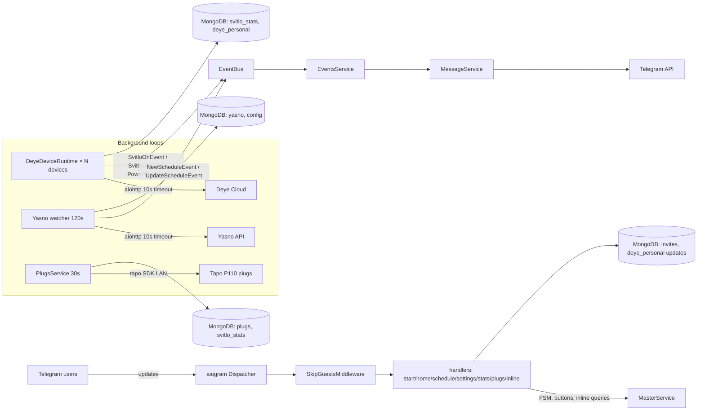

# PROJECT_CONTEXT.md

Persistent, verified context for the **ElectricBot** repository.
Last refreshed 2026-11-19 against branch **`refactor`**. Verify any specific claim against the current source before acting on it — code has moved a lot since the branch was cut.

---

## A. Project Identity

- **Name:** ElectricBot (package: `bot/`)
- **Purpose:** Telegram bot for Ukrainian households: watches a Deye solar/battery inverter, tracks Yasno planned-outage schedules, and optionally controls Tapo P110 smart plugs. Multi-tenant — one user per `DeyePersonal`, every feature opt-in via a nullable field on that document.
- **Status:** Working on `refactor` branch. Running locally for the admin; design is already multi-user (data model, invite flow, per-user channel/group/plug backend all in place).
- **Constraints / limits:**
  - Tapo plug control requires the bot to run on the plug's LAN (Tapo P110 local-control API). VPS deployment loses plug features.
  - Only `tapo_local` plug backend exists today; `DeyePersonal.plug_service` is a string so a `tapo_cloud` / `shelly_cloud` dispatch split is future-ready.
  - Yasno watcher polls the public API every 120 s.
  - Deye runtime polls every 30 s per device; one global shared aiohttp session.
  - All user-facing text is Ukrainian; code comments and docstrings are English.

## B. Technology Stack

| Area | Tech | Verified in |
|---|---|---|
| Language | Python 3.12 | `bot/Dockerfile` |
| Bot framework | aiogram 3.22.0 | `bot/requirements.txt`, `bot/__main__.py` |
| HTTP (async) | `aiohttp` 3.12.15 | `bot/clients/deye_client.py`, `bot/clients/yasno_client.py`, `bot/utils/check_internet_connection.py` |
| MongoDB driver | `motor` 3.7.1 | `bot/db/mongodb.py` |
| Smart plugs | `tapo` 0.8.8 | `bot/clients/plug_client.py` |
| Image rendering | `pillow` 12.1.1 | `bot/services/image/render.py` |
| Config | `python-dotenv` 1.2.1 | `bot/settings/dotenv_config.py`, `bot/settings/helpers.py` |
| Timezone | `pytz` | `bot/utils/_time.py` |
| Container | 2-stage Dockerfile + `docker-compose.yml` | `bot/Dockerfile`, `docker-compose.yml` |

External services: Telegram Bot API, Deye Cloud (`eu1-developer.deyecloud.com`), Yasno public blackout API (`app.yasno.ua`), Tapo cloud (via `tapo` library), MongoDB Atlas.

Not actively used anymore: `requests` is still pinned but no longer imported — safe to drop.

## C. Repository Map

```
bot/
  __main__.py                 # entry: logging, master wiring, DB setup, bootstrap,
                              # background tasks, dispatcher, /start command register,
                              # start_polling, graceful shutdown (per-task cancel + aiohttp close)
  bot_.py                     # singleton aiogram Bot (HTML parse mode)
  metrics.py                  # Deye metric key constants + OBSERVER_METRICS
  Dockerfile                  # 2-stage; installs fonts-dejavu-core + uk_UA locale
  requirements.txt            # pinned deps (still UTF-16 LE BOM — see DX-02)
  .env                        # local secrets (gitignored via *.env pattern)
  .env.example                # template for every env var the code reads

  clients/
    deye_client.py            # aiohttp Deye client + DeyeClientManager (shared session, timeout=10)
    yasno_client.py           # aiohttp Yasno fetcher, 5-min in-memory cache (all groups in one response)
    plug_client.py            # tapo.ApiClient wrapper (reads TAPO_USERNAME/PASSWORD from env)

  db/
    mongodb.py                # Motor client + create_db_indexes (device_sn unique, invites TTL 24h)
    methods/                  # re-exported as `mongodb.*` through db/methods/__init__.py (* imports)
      svitlo_stats.py         # create_light_on/off, get_last_event, date-range queries
      deye_personal.py        # DeyePersonal CRUD, set_yasno_group/set_channel_id/by_plug_service helpers
      plugs.py                # Plug CRUD + force_update_plug
      yasno_schedule.py       # per-(date, group) yasno docs + per-channel pinned-msg_id
      invites.py              # create_invite / consume_invite (24h TTL)

  handlers/                   # split by concern; each file owns one Router
    __init__.py               # routers = [start, settings, stats, home, schedule, plugs, inline]
    _shared.py                # last_yasno_for(personal) helper
    start.py                  # /start → welcome + pin + reply-kb; handles invite_<token> payload
    home.py                   # 🏠 Хата button + "refresh" inline callback
    schedule.py               # 💡 Світло button
    settings.py               # ⚙️ Меню + /cancel, FSMs for yasno_group + channel_id + invite kb
    stats.py                  # 📊 submenu, stats:7/14/month_current/month_previous,
                              # /stats legacy CLI, copy_to_channel
    plugs.py                  # 🔌 Розетки + plug toggle callbacks; router-level FilterHasPlugService
    inline.py                 # @router.inline_query → InlineQueryResultArticle for invite flow

  menus/
    main_menu.py              # status menu + send_stats_to_channel_menu
    plug_menus.py             # plug list + per-plug settings keyboards
    reply_menu.py             # BTN_STATUS/SCHEDULE/PLUGS/MENU constants + build_main_reply_kb(personal)
    settings_menu.py          # SettingsState FSM (waiting_for_yasno_group, waiting_for_channel_id)
                              # + build_settings_menu(personal)
    stats_menu.py             # build_stats_menu (7d / 14d / month_current / month_previous)

  middlewares/
    skip_guests.py            # electric_members allowlist; narrow bypass for /start invite_<token>
    filters.py                # FilterHasPlugService (router-level on handlers/plugs.py)

  settings/
    dotenv_config.py          # loads env, reads STAGE/DEV_BOT_TOKEN/PROD_BOT_TOKEN,
                              # TAPO_*, MONGO_CONNECTION_STRING; builds deye_basic from
                              # USER_ID/DEVICE_SN/APP_ID/APP_SECRET/EMAIL/PASSWORD/BATTERY_CAPACITY_KWH
    helpers.py                # _looks_hashed / _sha256 / _persist_env (set_key back to .env)
    electric_members.py       # in-memory allowlist (user_ids from all DeyePersonal rows),
                              # refreshed at startup and after accept-invite

  services/
    master_service.py         # composition root — instantiates everything in one place
    bootstrap.py              # ensure_first_personal() on empty deye_personal
    event_bus.py              # ★ typed, in-process async event bus:
                              # - subscribe by event type; returns Subscription handle
                              # - sequential dispatch by default; opt-in concurrent=True + timeout=
                              # - per-handler error isolation (log + continue)
                              # - middleware chain via bus.use(mw) with async call_next
                              # - PEP-562 __getattr__ not used here; see services/image/const_.py
    device_runtime.py         # ★ DeyeDeviceRuntime (per-device poll loop) + DeyeManager
                              # (spawns runtime per DeyePersonal, caches last data,
                              # fail-soft: returns stale cache on fetch error)
    events_service.py         # subscribes to SvitloOn/Off/PowerAlert/New/UpdateSchedule events,
                              # routes DMs to deye_personal.user_ids and channel posts to
                              # personal.channel_id (gated; None → no channel)
    yasno.py                  # Yasno watcher — collects unique groups across personals,
                              # ticks each group once per 120s cycle; prime_group(group) method
                              # for immediate fetch after the user sets yasno_group
    plugs_service.py          # plug watcher — finds the personal with plug_service=='tapo_local',
                              # drives plug state from their svitlo events; skips tick cleanly
                              # when no such personal exists
    msg_service.py            # Telegram send helpers; per-channel pinned-msg flow
                              # (send_new_schedule / update_schedule by channel_id);
                              # dev_ids currently read from dotenv_config.deye_basic.user_ids —
                              # ⚠ crashes if deye_basic is None (see Open risks)
    image/
      main.py                 # get_stats(y,m,d,duration,device_sn) — legacy CLI /stats
                              # get_stats_last_days(device_sn, n) — last N complete days
                              # get_stats_current_month(device_sn)
                              # get_stats_previous_month(device_sn)
      render.py               # PIL draw_stats; generate_visual_stats wraps in asyncio.to_thread
      const_.py               # Pillow fonts via PEP-562 module __getattr__ — lazy, with
                              # ImageFont.load_default() fallback (so macOS dev doesn't crash)
    texts/
      text_service.py         # per-field formatters (SOC, battery, source, voltage, etc.)
      templates.py            # f-string templates (status, channel-svitlo-on/off, hata-*, power-alert)
      templates_service.py    # init_text_service + bot_main_menu + hata/channel/power-alert formatters
      yasno_texts.py          # get_schedule_text / get_n_line_schedule; tolerates yasno=None

  types_/
    types.py                  # TypedDicts for Deye + Yasno raw payloads
    mixin_types.py            # dataclasses: ScheduleYasno, SvitloItem, Alerts (TypedDict),
                              # DEFAULT_ALERTS, BasicDeyePersonal (bootstrap), DeyePersonal
                              # (full, with optional yasno_group/channel_id/plug_service),
                              # Plug, DeyeItem, SvitloOnEvent/SvitloOffEvent/PowerAlertEvent,
                              # NewScheduleEvent/UpdateScheduleEvent.
                              # DeyePersonal.from_basic(basic, alerts=None) classmethod.
    mongo_mixin.py            # MongoDataclassMixin.from_dict (ignores unknown Mongo fields)

  utils/
    _time.py                  # tz_now (Europe/Kyiv), minutes_to_hhmm, humanize_minutes/seconds,
                              # normalize_yasno_date
    check_internet_connection.py  # startup gate — 5s GET to google.com

  tests/
    test_event_bus.py         # 11 pytest cases for EventBus (no pytest-asyncio needed;
                              # uses asyncio.new_event_loop + run_until_complete)
    main.py                   # one-off: DeyeManager.get_item + pprint
    add_deye_personal.py      # manual DeyePersonal insert via BasicDeyePersonal + from_basic
    add_plug.py               # register a new Tapo P110 plug in Mongo
    deye_metric.py            # probe any AllMetric.X for a user
    deye_rate_limit.py        # sequential Deye API throughput probe
    deye_rate_limit_parallel.py  # asyncio.gather N requests at once
    emit_events.py            # manually fire SvitloOn/Off / PowerAlert / New/UpdateSchedule

docker-compose.yml           # single `bot` service, env_file: bot/.env, restart: always
LICENSE                      # MIT
README.md                    # public-facing — pitch, Mermaid, features, setup, testing
PROJECT_CONTEXT.md           # this file
```

### Files that were deleted or moved since the last snapshot

- `bot/const.py` **removed** — the last constant it held (`DEV = 357108179`) was redundant with `.env USER_ID`. Any `import const` in the codebase was dropped.
- `bot/services/deprecated_stats.py` and `bot/services/image/helpers.py` — both dead code; removed.
- `handlers/main.py` — split into the 7 handler files above.
- `huinya.py` — orphan scratch file still in the repo root; harmless but should be deleted.

### Files worth opening first for specific investigations

- "Notification didn't fire" → `services/events_service.py` + `services/device_runtime.py:_watch_svitlo`.
- "Schedule wrong / nothing" → `services/texts/yasno_texts.py`, `services/yasno.py`, `clients/yasno_client.py`.
- "Can't reach Deye" → `clients/deye_client.py`, `services/device_runtime.py:_fetch_deye_data`.
- "Plug didn't toggle" → `services/plugs_service.py`, `clients/plug_client.py`, `handlers/plugs.py`.
- "Startup fails" → `bot/__main__.py`, `settings/dotenv_config.py`, `db/mongodb.py`, `services/bootstrap.py`.
- "Invite link broken" → `middlewares/skip_guests.py:_is_invite_bypass`, `handlers/start.py:_handle_invite`, `db/methods/invites.py`, `handlers/inline.py`.

## D. Architecture and Execution Flow

Startup sequence in `__main__.main()`:

1. `logging.basicConfig` + internet connectivity gate (`check_internet_connection`).
2. `create_master_service()` — instantiates everything (see MasterService below).
3. `create_db_indexes()` — `deye_personal.device_sn` unique, `invites.created_at` TTL=24h.
4. `ensure_first_personal()` — if `deye_personal` is empty and `.env` has the bootstrap block, insert a seeded `DeyePersonal.from_basic(dotenv_config.deye_basic)`.
5. `electric_members.update()` — load the allowlist from all `DeyePersonal.user_ids`.
6. Spawn `master_service.new_yasno.start()` and `master_service.plugs.start()` as background tasks.
7. Build `Dispatcher(master_service=master_service)`, apply `SkipGuestsMiddleware`, include every router from `handlers/__init__.routers`.
8. `set_bot_commands(bot)` — hamburger menu registers only `/start — 🚀 Запустити бота`.
9. `master_service.run()` — reads all `DeyePersonal` rows, `ensure_device` spawns one `DeyeDeviceRuntime` task per device.
10. `dp.start_polling(bot)`.
11. On shutdown: `for t in background_tasks: t.cancel()` + `await asyncio.gather(..., return_exceptions=True)` + `await master_service.deye_client_manager.close()` — the shutdown bug was fixed in commit `024cc27`.

### The composition root — `MasterService`

Single file (`services/master_service.py`, 42 lines) wires every long-lived object:

```python
self.msg = create_message_service()           # Telegram sends
self.event_bus = EventBus()                   # typed pub/sub
self.new_yasno = Yasno(self.event_bus)        # Yasno watcher
self.deye_client_manager = DeyeClientManager() # shared aiohttp session for Deye
self.deye_manager = DeyeManager(...)          # spawns per-device runtimes
self.templates = TemplatesService(self)       # message formatting
self.events = EventsService(self, self.event_bus)  # subscribes to bus
self.plugs = PlugsService()                   # plug watcher
```

### Runtime data flow



### Event bus contract (`services/event_bus.py`)

Module docstring:

- **At-most-once, in-process** — events are not persisted or replayed.
- **Exact-type match** — a handler for `Base` does not see subclass events.
- **Sequential, in registration order** — unless caller passes `concurrent=True`.
- **Errors are logged and swallowed** — one failing handler doesn't stop the others. In `concurrent=True` mode errors are collected via `asyncio.gather(return_exceptions=True)` and logged per handler.
- **`subscribe()` returns a `Subscription`** — supports `with` and `.unsubscribe()`.
- **Middleware** via `bus.use(mw)` — `async def mw(event, call_next): ...`; composed recursively through `_chain(index, event, dispatch)`.
- **No inheritance dispatch, no persistent queue, no wildcards** — deliberate scope limits.

### Invite flow (deep link + inline chat picker)

1. Owner taps ⚙️ Меню → 👥 Запросити користувача → **📤 Поділитись з другом** (a button with `switch_inline_query_chosen_chat(query="invite", allow_user_chats=True)`).
2. Telegram opens the native chat picker filtered to user chats.
3. Owner picks a friend → Telegram jumps into that chat with `@botname invite` pre-filled → fires an inline query.
4. `handlers/inline.py:inline_invite` responds with an `InlineQueryResultArticle` containing a pre-formatted invite message and an inline keyboard whose single button has `url=t.me/<bot>?start=invite_<token>`. A fresh token is minted via `mongodb.create_invite(owner.device_sn)` per call.
5. Owner taps "Send" → the article posts in the friend's chat.
6. Friend taps the Join button → opens the bot with `/start invite_<token>`.
7. `SkipGuestsMiddleware._is_invite_bypass` sees the exact string `/start invite_` and lets the non-member through this one time.
8. `handlers/start.py:_handle_invite` calls `mongodb.consume_invite(token)` (atomic `find_one_and_delete`), `add_user_to_device`, `electric_members.update()`, confirms the user, and falls through to the normal welcome + pin + reply-kb.

## E. Configuration and Operations

### Environment variables (names only — never inline values here)

| Variable | Used by | Notes |
|---|---|---|
| `STAGE` | `settings/dotenv_config.py` | `"dev"` → `DEV_BOT_TOKEN`, otherwise `PROD_BOT_TOKEN`. |
| `DEV_BOT_TOKEN` | same | Telegram bot token for development. |
| `PROD_BOT_TOKEN` | same | Telegram bot token for production. |
| `MONGO_CONNECTION_STRING` | `db/mongodb.py` | Atlas URL. Hardcoded DB name `"Electric"` in `db/mongodb.py`. |
| `TAPO_USERNAME` / `TAPO_PASSWORD` | `clients/plug_client.py` via `dotenv_config` | Tapo cloud credentials (used only for the handshake; subsequent control is LAN). |
| `USER_ID`, `DEVICE_SN`, `APP_ID`, `APP_SECRET`, `EMAIL`, `PASSWORD`, `BATTERY_CAPACITY_KWH` | `settings/dotenv_config._try_load_deye_basic` | Deye bootstrap block — collectively populate `BasicDeyePersonal`; only consumed by `services/bootstrap.ensure_first_personal` when `deye_personal` is empty. **`PASSWORD` is auto-hashed and written back** on first boot if it isn't already 64-char hex. |

Not env-driven (per-user, in Mongo): `yasno_group`, `channel_id`, `plug_service`, `alerts[]`, `access_token`, `refresh_token`.

### DB collections

| Collection | Owned by | Shape |
|---|---|---|
| `deye_personal` | `db/methods/deye_personal.py` | one doc per registered user. See `types_/mixin_types.DeyePersonal`. |
| `svitlo_stats` | `db/methods/svitlo_stats.py` | one doc per on/off transition, keyed by `device_sn` + `timestamp`. |
| `yasno` | `db/methods/yasno_schedule.py` | one doc per `(date_str, group)` with an `updates: [ScheduleRaw]` array. |
| `config` | `db/methods/yasno_schedule.py` | `_id = "schedule_msg:{channel_id}"` → stores the pinned message id per channel. |
| `plugs` | `db/methods/plugs.py` | one doc per plug by IP. `watcher_enabled`, `is_online`, `device_on`. |
| `invites` | `db/methods/invites.py` | `_id = token`, TTL 24h via `created_at` index. |

### Start commands

Local:
```bash
cd bot
pip install -r requirements.txt
python __main__.py
```

Docker:
```bash
docker compose up --build   # reads bot/.env, builds bot/Dockerfile
```

Pytest:
```bash
cd bot
pip install pytest
pytest tests/test_event_bus.py -v    # 11 cases, all green
```

Scratch probes in `bot/tests/` are run as plain scripts (not via pytest): `python tests/<name>.py` from `bot/`.

## F. Testing and Quality Controls

- **Real tests:** `bot/tests/test_event_bus.py` — 11 cases covering typed dispatch, sequential ordering, per-handler error isolation, unsubscribe via `.unsubscribe()` and `with`, decorator registration, concurrent-mode in parallel, middleware chain, timeout, no-handler noop, exact-type match (no inheritance dispatch).
- **Scratch probes** (manual, not pytest): `main.py`, `add_deye_personal.py`, `add_plug.py`, `deye_metric.py`, `deye_rate_limit.py`, `deye_rate_limit_parallel.py`, `emit_events.py`.
- **No CI, no linter config, no mypy config.** `pyproject.toml` absent. `requirements.txt` is still UTF-16 LE with BOM.
- **Static artifacts observed this session:** `git ls-files`, `git log`, `git diff --stat`, `git check-ignore`, `wc -l`, `find`. No network calls, no tests run, no builds.

## G. Confirmed Findings and Open Risks

| ID | Severity | Status | Summary |
|---|---|---|---|
| REL-01 | High | ✅ fixed | Blocking `requests` → migrated to `aiohttp` on `refactor` branch. |
| REL-02 | High | ✅ fixed | Deye HTTP had no timeout → `ClientTimeout(total=10)` on shared session. |
| REL-03 | High | ✅ fixed (commit `024cc27`) | `asyncio.gather(*tasks).cancel()` cancelled the wrapper, not tasks. |
| REL-04 | Medium | ⚠ open | `_watch_svitlo` double-fire race if Telegram is slow and the next Deye tick runs before the new svitlo_stats row is persisted. |
| REL-05 | Medium | ⚠ open | `_merge_today_tomorrow` in `services/texts/yasno_texts.py:68-71` mutates the input dict and adds two absolute-minute values incorrectly. |
| REL-NEW-01 | High | ✅ fixed | `_watch_svitlo` first-run `AttributeError` — fixed by assigning `prev_event` after seeding. |
| REL-NEW-02 | High | ⚠ open | `services/msg_service.py:18` — `self.dev_ids = dotenv_config.deye_basic.user_ids` crashes if `deye_basic is None`. Only reachable on deployments that skip the bootstrap env block. |
| IMG-01 | High | ✅ fixed (commit `799a2b2`) | Pillow fonts loaded at import → PEP-562 `__getattr__` + `load_default()` fallback. |
| IMG-02 | Medium | ✅ fixed (commit `799a2b2`) | `generate_visual_stats` now wraps `draw_stats` in `asyncio.to_thread`. |
| IMG-03 | Medium | ⚠ open | `draw_stats` still writes `stats.png` into `bot/services/image/` on every call (`_save_pic` call is unguarded). |
| SEC-01 | Critical | ⚠ open | Deye credentials in git history (`3d07ace`, `1b174fe`). Current working tree is clean. |
| SEC-02 | Critical | ⚠ open | Tapo credentials in git history (`3b19d41`, `59fc205`, others). Current working tree is clean. |
| SEC-03 | Medium | ⚠ open | Startup doesn't validate required env vars — failures manifest as late tracebacks. |
| SEC-04 | Medium | ✅ fixed | `copy_to_channel` callback now requires `personal.channel_id` present. |
| ARCH-01 / ARCH-02 | Medium | ⚠ open | `Yasno` and `PlugsService` instantiate their own `create_message_service()` instead of accepting `MasterService.msg`. |
| CODE-01 | Medium | ✅ fixed | `const.py` removed; `DEV` was redundant with `.env USER_ID`. |
| CODE-02 | Medium | ✅ fixed | `__main__` scratch harnesses removed from every non-test module. |
| DOC-01 | Medium | ✅ fixed | `README.md` + `LICENSE` added. |
| DX-01 | Low | ⚠ open | `huinya.py` still in repo root (zero bytes). `.gitignore` is `*.env + *.png + .idea + .claude`. |
| DX-02 | Low | ⚠ open | `bot/requirements.txt` still UTF-16 LE with BOM. |
| DX-03 | Low | ⚠ open | Dockerfile `WORKDIR /app` + `CMD python bot/__main__.py` works only because Python prepends the script's dir to `sys.path`. |

Not an audit finding but worth knowing:
- `_save_pic` in `services/image/render.py` writes a `stats.png` into the package dir. Covered by `.gitignore: *.png`, so no commit noise, but it's a per-call fs write.
- `services/image/main.get_stats_all_time` exists but has no callers after the menu refactor — can be deleted, kept as a library helper for now.

## H. Architecture Decisions and Constraints

Decisions worth not reversing without thought:

1. **Composition root (`MasterService`)** — one place to instantiate; no DI framework. If you add a new long-lived service, it belongs here, not in a module-level singleton.
2. **Per-device runtime** — `DeyeManager.ensure_device → DeyeDeviceRuntime`. Already handles N devices even though prod has 1.
3. **Typed event bus with explicit contract** — documented in the module docstring. The semantics (at-most-once, exact-type, sequential default, logged+swallowed errors) are intentional; don't quietly change them.
4. **Mongo as single source of truth** — alert `triggered` flags, svitlo events, Yasno snapshots, pinned msg ids, invite tokens all persist. On restart nothing needs to be replayed.
5. **Per-personal opt-in features** — `yasno_group` / `channel_id` / `plug_service` all `Optional`. `build_main_reply_kb(personal)` adapts; non-set users don't see buttons they can't use.
6. **Dynamic allowlist (`electric_members`)** — loaded at startup, refreshed on invite accept. New users without an invite get silently dropped by the middleware.
7. **Invite bypass is a narrow string match** — `event.text.startswith("/start invite_")` — not a general flag. Any other `/start ...` payload goes through the normal allowlist.
8. **Bootstrap-on-empty-DB + password auto-hash** — first start is frictionless from `.env`. Reading a plaintext `PASSWORD` triggers `_sha256` + `set_key` to write the hash back in place.
9. **Channel pin storage keyed on `channel_id`** — `config._id = "schedule_msg:{channel_id}"`. Scales to as many channels as you have personals.
10. **Dispatch router order** — settings first (owns the unified `/cancel`), then stats, then home/schedule/plugs/inline. Non-overlapping by design.

Unknown / undocumented reasoning: none important enough to flag; the `CHANGES.md` write-ups captured the big ones (per-group Yasno, per-personal channel, plug feature flag).

## I. Audit and Improvement Roadmap

Still open from the last `OPEN_SOURCE_REVIEW.md`:

**Before publishing to GitHub:**
1. Rotate every credential in `git log -S` — Deye `APP_SECRET`, Deye password, Tapo password, `PROD_BOT_TOKEN`.
2. `git filter-repo --replace-text` with every leaked literal; force-push to a fresh public repo.
3. Enable GitHub secret scanning on the new repo.

**Follow-ups:**
- **REL-NEW-02** — guard `MessageService.__init__` against `deye_basic is None`. One-line fix.
- **IMG-03** — stop writing `stats.png` on every `/stats` call (or gate behind `STAGE == "dev"`).
- **REL-04 / REL-05** — svitlo race + yasno merge bug.
- **DX-02** — re-encode `requirements.txt` as UTF-8 without BOM.
- **DX-01** — delete `huinya.py`.
- **ARCH-01 / ARCH-02** — inject a shared `MessageService` into Yasno/PlugsService.
- **SEC-03** — validate required env on startup; raise with a clear "missing env: X" message.
- Add a `.github/workflows/ci.yml` running `pytest bot/tests/test_event_bus.py`.
- Add `pyproject.toml` with `ruff` + `mypy` config.

## J. Inspection Boundaries

**Inspected this session** (read / grep-verified):
- Every `.py` file under `bot/` present in `git ls-files`.
- `bot/Dockerfile`, `docker-compose.yml`, `.gitignore`, `.env.example` (templates only).
- `git log --all -S <token>` for every secret still present in `bot/.env`.
- `git ls-files`, `git status`, `git diff --stat`.
- The current rendering code path (`services/image/*`), the event bus and its tests, every handler file, every service file.

**Not inspected:**
- Live MongoDB contents.
- Live Deye / Yasno / Tapo / Telegram traffic.
- `.venv/`, `.idea/`, `__pycache__/` artifacts.
- The PNG output of `/stats` under real data.

**Known unknowns:**
- Whether the Deye `APP_SECRET` / Deye password / Tapo password that leaked in history have actually been rotated at the provider. No way to verify from inside the repo.
- Whether `bot/__main__.py` runs cleanly on macOS end-to-end (the PIL font path is handled; haven't booted the full dispatcher).
- Whether an already-seeded deployment (no `deye_basic` env block) boots — `MessageService.__init__` currently blocks it (REL-NEW-02).
