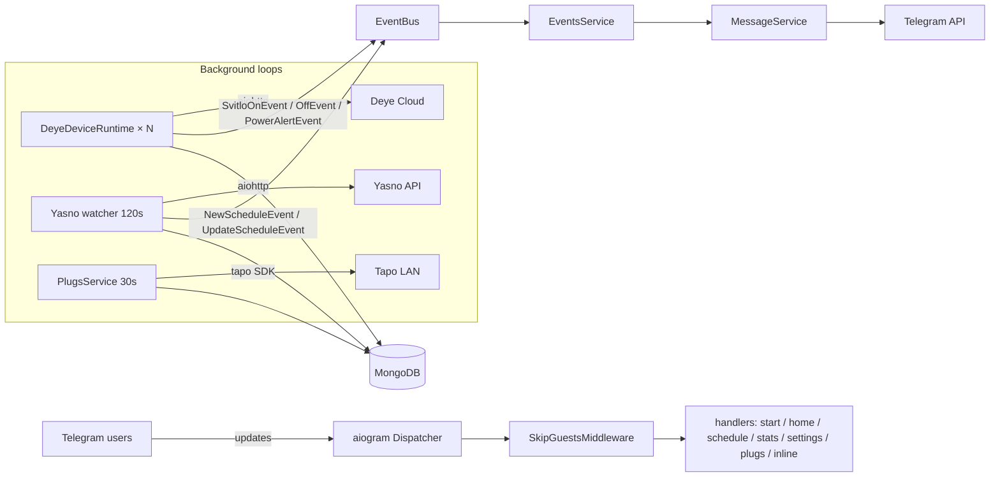

# ⚡ ElectricBot

> Telegram bot that watches a Ukrainian home's electricity situation — Deye solar inverter, Yasno blackout schedules, Tapo smart plugs — and gives each household its own dashboard, schedule, alerts, and automation.


Built for multi-tenant use: every registered user has their own Deye device, their own blackout group, optionally their own Telegram channel, and optionally their own smart-plug backend. Features are opt-in — the UI adapts per user based on what they've configured.

---

## Features

- 🏠 **Live status** — current SOC, battery direction, time-to-full/empty, "source" (grid vs battery), updated-at timestamp.
- 💡 **Yasno schedule** — pulls planned-outage data for the user's `yasno_group`, renders today + tomorrow, and shows the current slot inline on the status card.
- 📊 **Image stats** — hourly on/off grid for a date range with header + "best/worst" blocks, rendered to PNG with Pillow. Pick 7 days, 14 days, this month, or last month.
- 🔌 **Tapo smart plugs** — auto-toggles plugs based on grid state; manual toggle + per-plug "auto-control" switch in the menu. Admin-only in the current deployment, opt-in per user by setting `plug_service="tapo_local"`.
  > ⚠ **LAN-only**: the Tapo P110 uses a local control API — **the bot process must run on the same network as the plugs**. A VPS deployment can't control them. Supports **Tapo P110 only** today; other models (P100 / P105 / P115) would need `PlugClient` changes.
- 📢 **Channel broadcasting** — users with a `channel_id` get their group's blackout schedule pinned to their channel and auto-edited every tick, plus `svitlo_on/off` posts.
- 👥 **Invite flow** — owners can share deep links via Telegram's native **chat picker** (`switch_inline_query_chosen_chat`) → inline-article → `t.me/<bot>?start=invite_<token>`. One-click guest joining, with the Mongo `invites` collection TTL-cleaned every 24 h.
- ⚙️ **In-app settings** — FSM-driven menu to set `yasno_group`, verify + save `channel_id` (bot posts a test message first; only persists if it worked), invite members.
- 🚀 **Bootstrap on empty DB** — first boot reads `.env`, auto-hashes the Deye password if it's plaintext, writes `.env` back, inserts the first `DeyePersonal`. Zero manual DB prep.

## Architecture at a glance



**Highlights worth looking at in the source:**

- [`bot/services/event_bus.py`](bot/services/event_bus.py) — a typed, in-process async event bus with per-handler error isolation, a `Subscription` handle, and an opt-in middleware chain. **85 lines + 11 pytest cases** in [`bot/tests/test_event_bus.py`](bot/tests/test_event_bus.py).
- [`bot/services/device_runtime.py`](bot/services/device_runtime.py) — per-device polling loop; fail-soft with stale-cache fallback; isolated in-memory alert state per device.
- [`bot/services/master_service.py`](bot/services/master_service.py) — explicit composition root. No DI framework. All services instantiated and wired in one place.
- [`bot/handlers/inline.py`](bot/handlers/inline.py) — the invite flow's inline-query handler. Returns an `InlineQueryResultArticle` with a `url=t.me/.../?start=invite_<token>` button, personalized per owner.
- [`bot/middlewares/skip_guests.py`](bot/middlewares/skip_guests.py) — guest allowlist, with a precise bypass for `/start invite_<token>` so new members can join before they're on the list.

## Tech stack

| Area | Choice |
|---|---|
| Language | Python 3.12 |
| Bot framework | [aiogram 3.22](https://github.com/aiogram/aiogram) |
| HTTP (async) | aiohttp 3.12 |
| MongoDB driver | [Motor 3.7](https://motor.readthedocs.io/) |
| Smart plugs | [tapo 0.8](https://pypi.org/project/tapo/) |
| Image rendering | Pillow 12 |
| Config | python-dotenv |
| Container | 2-stage Dockerfile + `docker-compose.yml` |

External APIs: Telegram Bot API, Deye Cloud (`eu1-developer.deyecloud.com`), Yasno public blackout API (`app.yasno.ua`), Tapo cloud (via `tapo` library), MongoDB Atlas.

## Getting started

### 1. Prereqs

- Python 3.12 (locally) **or** Docker 24+ with Docker Compose v2.
- A MongoDB instance (Atlas free tier works).
- A Telegram bot token from [@BotFather](https://t.me/BotFather). **Enable inline mode** (`/mybots → Bot Settings → Inline Mode → Turn on`) — required for the invite share flow.
- A Deye Developer account (for `APP_ID` / `APP_SECRET`) and the device's SN.
- (Optional) Tapo Cloud credentials if you want plug control.
  - 🔌 **If you want plug control, the bot must run on the same LAN as the plugs** (not on a cloud VPS) — the Tapo P110 is controlled via its local API. Only the **Tapo P110** model is supported today.

### 2. Configure

Copy the template and fill it in:

```bash
cp bot/.env.example bot/.env
# then edit bot/.env with your values
```

Every variable listed is explained inline in [`bot/.env.example`](bot/.env.example). The plaintext `PASSWORD` is auto-hashed on first boot and persisted back to the file.

### 3. Run

**Docker (recommended):**

```bash
docker compose up --build
```

**Local:**

```bash
cd bot
pip install -r requirements.txt
python __main__.py
```

On first start, if `deye_personal` is empty and `.env` has the bootstrap vars, ElectricBot auto-creates the first `DeyePersonal` and spawns the Deye runtime. No manual DB seeding needed.

### 4. In Telegram

- Send `/start` to your bot. The welcome message is pinned and a reply keyboard appears.
- Tap **⚙️ Меню → 📝 Змінити групу Ясно** to set your Yasno queue (e.g. `25.1`).
- Tap **⚙️ Меню → 📢 Встановити канал** to connect a channel (bot will probe before saving).
- Tap **⚙️ Меню → 👥 Запросити користувача → 📤 Поділитись з другом** to invite someone from your contacts.

## Project layout

```
bot/
├── __main__.py                 # entry: wiring, bootstrap, polling
├── bot_.py                     # singleton Bot instance
├── const.py                    # non-secret constants (DEV user_id)
├── clients/                    # Deye / Yasno / Tapo HTTP clients
├── db/
│   ├── mongodb.py              # Motor client + index creation
│   └── methods/                # grouped async CRUD (collected via __init__ *)
├── handlers/                   # aiogram routers — one file per concern
├── menus/                      # keyboards + menu builders
├── middlewares/                # SkipGuestsMiddleware, FilterHasPlugService
├── services/
│   ├── event_bus.py            # ★ typed async event bus + middleware
│   ├── device_runtime.py       # ★ per-device polling loop
│   ├── events_service.py       # subscribes to the bus, produces Telegram sends
│   ├── master_service.py       # composition root
│   ├── bootstrap.py            # first-start seed from .env
│   ├── yasno.py                # Yasno schedule watcher (per group)
│   ├── plugs_service.py        # Tapo plug watcher + manual toggle
│   ├── image/                  # Pillow stats renderer
│   └── texts/                  # templates + status/schedule rendering
├── settings/                   # dotenv_config, electric_members allowlist
├── tests/                      # pytest + scratch probes (see below)
├── types_/                     # dataclasses + Mongo mixin
└── utils/                      # tz_now, humanize_minutes, …
```

## Testing

```bash
cd bot
pip install pytest
pytest tests/test_event_bus.py -v
```

The `test_event_bus.py` suite is the main behavioral spec for the event bus — 11 cases covering typed dispatch, ordering, error isolation, unsubscribe (both forms), decorator registration, concurrent mode, middleware, timeout, no-handler noop, and exact-type-match.

The rest of `tests/` are **scratch probes** for manual use:

| File | Purpose |
|---|---|
| `add_deye_personal.py` | Register a new DeyePersonal in Mongo. |
| `add_plug.py` | Register a new TAPO P110 plug (LAN-only; same network as bot). |
| `deye_metric.py` | Probe any `AllMetric.X` for a given user. |
| `deye_rate_limit.py` | Measure sustained Deye API throughput (sequential). |
| `deye_rate_limit_parallel.py` | Burst-load test (all-at-once, via `asyncio.gather`). |
| `emit_events.py` | Manually trigger `SvitloOn/Off / PowerAlert / New/UpdateSchedule` to test the pipeline end-to-end. |
| `main.py` | One-shot `DeyeManager.get_item` → pprint. |

## Recent engineering

- [`fix: cancel background tasks on shutdown`](../../commit/024cc27) — `asyncio.gather(*tasks).cancel()` was cancelling the wrapper, not the tasks; Yasno and plug loops leaked until process-kill.
- [`fix: don't crash when deye_basic is None`](../../commit/e804e22) — `MessageService.__init__` dereferenced an `Optional` without a guard; already-seeded deployments without the bootstrap env block couldn't boot.
- [`fix: lazy-load PIL fonts and render off the event loop`](../../commit/799a2b2) — fonts now resolve on first access with a `load_default()` fallback (macOS dev no longer breaks the import), and `generate_visual_stats` wraps the Pillow draw in `asyncio.to_thread` so `/stats` stops freezing the dispatcher.

## Documentation

- [`PROJECT_CONTEXT.md`](PROJECT_CONTEXT.md) — verified architecture notes, current data model, open risks, inspection boundaries.
- [`OPEN_SOURCE_REVIEW.md`](OPEN_SOURCE_REVIEW.md) — pre-publication assessment (secrets, bugs, and what still blocks "wow").

## Contributing

Issues and PRs welcome. Keep in mind the deliberate architecture decisions:

- **Composition root** in `master_service.py` is the only place to instantiate services.
- **Event bus** contract is at-most-once, in-process, exact-type-match, sequential-by-default. Don't reach for a persistent broker.
- **Per-device runtime** is designed for N Deye accounts; don't collapse it.
- **MongoDB is the single source of truth** for state. Alerts, svitlo events, Yasno snapshots, channel pin ids, invite tokens all persist.

Run the event-bus tests before opening a PR:

```bash
cd bot && pytest tests/test_event_bus.py -v
```

## License

[MIT](LICENSE) © 2026 Oleksandr Dasenko
